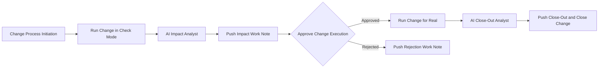

# Check Mode Change Control

See the impact before you commit. A change process initiates the workflow, AAP runs the multi-domain change in **check mode** (nothing is applied), an AI step scans the dry-run output and writes a detailed impact work note that is pushed to the change request through a **SNOW job template**, and a human approves — or rejects — before the change runs for real.

## What this demo shows

The change process (simulated by an AAP job) creates a change request in ServiceNow and fires the automation orchestrator webhook with the new change number. AAP then runs the multi-domain change job template **in check mode** — the playbook executes its full task set across web, database, and load-balancer host groups but modifies nothing, and publishes per-host impact data via `set_stats`.

An **AI impact analyst** reads those artifacts, groups the impact by domain, assesses risk, and writes a detailed markdown work note. The work note is pushed to the change request through the **Update SNOW Change** job template — all ServiceNow writes go through job templates, not AI agents.

An **approval step** is where the reviewer decides, looking at the impact report: approved, the same change runs for real via the apply job template, an **AI close-out analyst** scans what actually happened against the check-mode prediction, and the results are pushed to ServiceNow through the SNOW job template, which also closes the change request. Rejected, a work note recording the operator's rejection is pushed to the change request — no system was touched.

The AI model is configurable on both Task agents — tested with `claude-sonnet-4-6`.

## Workflow



### Step-by-step

| Step | Node | Type | What it does |
|------|------|------|--------------|
| 1 | **Change Process Initiation** | Webhook (`/change-request`) | A change process creates the change request in ServiceNow and POSTs the number, summary, and risk into automation orchestrator (simulated by an AAP job) |
| 2 | **Run Change in Check Mode** | AAP job | Launches `Multi-Domain Change - Check` (job_type: check) — full multi-domain dry run, nothing applied, impact published via `set_stats` |
| 3 | **AI Impact Analyst** | Task agent | Scans `${check_run.artifacts.*}`, groups impact by domain, counts tasks that would change, assesses risk, writes the detailed work note |
| 4 | **Push Impact Work Note to Change** | AAP job | Launches `Update SNOW Change` with the AI work note — attaches the impact report to the change request |
| 5 | **Approve Change Execution** | Approval | Reviewer decides with the impact report in hand |

#### Approved path

| Step | Node | Type | What it does |
|------|------|------|--------------|
| 6a | **Run Change for Real** | AAP job | Launches `Multi-Domain Change - Apply` (job_type: run) — the same playbook, now applying changes |
| 7a | **AI Close-Out Analyst** | Task agent | Scans the real-run artifacts against the check-mode prediction, writes the closure work note |
| 8a | **Push Close-Out and Close Change** | AAP job | Launches `Update SNOW Change` with the closure note and state 3 (Closed) |

#### Rejected path

| Step | Node | Type | What it does |
|------|------|------|--------------|
| 6b | **Push Rejection Work Note** | AAP job | Launches `Update SNOW Change` with a work note recording the operator's rejection — no system was modified |

## Check mode: one playbook, two job templates

The multi-domain playbook is registered twice in AAP:

| Job template | job_type | What happens |
|--------------|----------|--------------|
| `Multi-Domain Change - Check` | `check` | ansible-playbook runs with `--check`: every task reports what it *would* change, nothing is modified |
| `Multi-Domain Change - Apply` | `run` | The same playbook applies the changes |

The playbook is written to be safe in both modes: read-only discovery tasks set `check_mode: false`, change tasks report normally, and the impact summary branches on `ansible_check_mode` so the published artifacts always state whether it was a dry run.

## Multi-domain impact data

The playbook performs three representative change tasks on every host — package install, sysctl configuration, service enablement — and publishes one structured artifact per run:

```json
{
  "change_number": "CHG0030001",
  "dry_run": true,
  "hosts": [
    { "host": "web1", "domain": "web", "changed_tasks": ["package:chrony", "config:sysctl-kernel-panic-timeout"], "changed_count": 2 }
  ],
  "total_changes": 6
}
```

The AI impact analyst reads this from `${check_run.artifacts.ao_change_impact}`; the close-out analyst compares it against `${apply_run.artifacts.ao_change_impact}` — prediction versus reality.

## ServiceNow writes go through job templates

Every ServiceNow interaction is an AAP job template launch, the same pattern the Ticket Enrichment demo uses:

| Job template | What it does |
|--------------|--------------|
| `Update SNOW Change` | Looks up the change request sys_id by number and PATCHes it: work notes on every path, state 3 (Closed) on the approved path |
| `Simulate - Change Process Initiation` | Creates the change request via the ServiceNow REST API and fires the webhook |

The AI agents never write to ServiceNow — they only produce the work note text that the job template posts verbatim.

## Components (defaults — swappable)

| Component | Default in demo | Notes |
|-----------|-----------------|-------|
| Webhook | `/change-request` | Accepts any change process that can POST |
| AI model | `claude-sonnet-4-6` | Set per Task agent in the workflow |
| ITSM | ServiceNow | All writes via the `Update SNOW Change` job template |
| Multi-domain groups | `web`, `db`, `loadbalancer` | Inventory groups; one VM can be a member of all three |
| Baseline package | `chrony` | Override with the `baseline_package` extra var |
