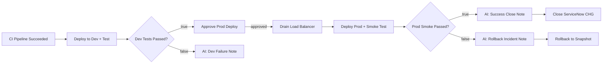

# CI/CD Pipeline — Dev Test, Approval, Prod Deploy with Rollback

Continuous delivery for a Lightwell-remediated dependency: CI validates the fix, then automation orchestrator owns everything after the green build — dev deploy and tests, a contextual human approval gate, load balancer drain, production deploy with smoke test, AI-written ServiceNow notes, and automatic snapshot rollback on failure.

**Demo video:** [Lightwell + AAP — Automated CI/CD from PR to Production](https://youtu.be/4iZCS4atxHQ)

## What this demo shows

Your security team flags CVE-2024-23334 in `aiohttp==3.9.0`. Lightwell backports a fix as `aiohttp==3.9.2.rhlw-00001`. A pull request bumps the dependency and records the ServiceNow change request. After merge, CI runs pytest and fires a webhook into automation orchestrator with app name, artifact version, git SHA, CI build URL, CVE ID, and change number.

Automation orchestrator then:

1. Deploys the artifact to **dev** (port 8080) and runs integration tests, posting work notes to the change request
2. Routes on `ao_dev_test_passed` — failure path writes an AI ServiceNow note and stops; success path reaches approval
3. Shows the approver full context (app, version, CVE, CI link, CHG number) — not a bare approve/reject
4. Drains the load balancer, deploys **prod** (port 80) with a pre-deploy snapshot, and smoke-tests `/health`
5. On success, an AI agent writes the close note and AAP closes the change; on failure, AI writes an incident note and Ansible restores the snapshot

Automation orchestrator does not replace your CI or ITSM — it coordinates the work between them from CI pass to production verification.

## Workflow



See [workflow.mermaid](workflow.mermaid) and the [demo marketplace page](https://ansible-tmm.github.io/aap-orchestrator-demos/demos/cicd-pipeline/).

### Step-by-step

| Step | Name | Type | What it does |
|------|------|------|--------------|
| 1 | **CI Pipeline Succeeded** | Webhook (`/lightwell-ci-cd`) | CI posts artifact metadata after tests pass |
| 2 | **Deploy to Dev, Test + SNOW Update** | AAP job | Deploys to port 8080, verifies version, posts SNOW work notes, publishes `ao_dev_test_passed` |
| 3 | **Dev Tests Passed?** | Condition | Routes true → approval; false → AI failure note |
| 4a | **Dev Lead Approval** | Approval | Contextual prompt with CVE, CI URL, and CHG number |
| 5a | **Drain Load Balancer** | AAP job | Graceful drain before prod change |
| 6a | **Deploy Prod + SNOW Updates** | AAP job | Snapshot, deploy port 80, smoke test, publish `ao_prod_health_passed` |
| 7a | **Prod Smoke Test Passed?** | Condition | Success → AI close note; failure → AI rollback note |
| 8a | **Close ServiceNow Ticket** | AAP job | Patches CHG to Closed with AI-written audit note |
| 8b | **Rollback to Snapshot** | AAP job | Restores pre-deploy snapshot after smoke failure |

## Playbooks

| Playbook | Job template name | Runs on | Purpose |
|----------|-------------------|---------|---------|
| `cicd_deploy_dev_and_test.yml` | CI/CD Demo - Deploy and Test Dev | Demo host | Dev deploy, integration tests, SNOW notes |
| `cicd_drain_lb.yml` | CI/CD Demo - Drain Load Balancer | Demo host | Pre-prod LB drain |
| `cicd_deploy_prod.yml` | CI/CD Demo - Deploy to Prod | Demo host | Snapshot, prod deploy, smoke test |
| `cicd_rollback_to_snapshot.yml` | CI/CD Demo - Rollback to Snapshot | Demo host | Restore prod from snapshot |
| `cicd_close_loop.yml` | CI/CD Demo - Close Loop | localhost | Close ServiceNow change request |
| `cicd_simulate_lightwell_pr.yml` | CI/CD Demo - Simulate Lightwell PR | localhost | Open SNOW CHG + Gitea PR (demo prep) |
| `cicd_reset_demo.yml` | CI/CD Demo - Reset Demo | Demo host | Reset Gitea repo to vulnerable baseline |

Setup playbooks live under [`setup/`](setup/):

| Playbook | Purpose |
|----------|---------|
| `cicd_setup_demo_host.yml` | Install inventory-service on ports 80 and 8080 |
| `cicd_setup_gitea.yml` | Install Gitea + act_runner with Podman |

## Artifacts

```
cicd-pipeline/
  README.md
  REQUIREMENTS.md
  workflow.mermaid
  ao/
    cicd-pipeline.json          # Import into automation orchestrator
  playbooks/
    cicd_deploy_dev_and_test.yml
    cicd_drain_lb.yml
    cicd_deploy_prod.yml
    cicd_rollback_to_snapshot.yml
    cicd_close_loop.yml
    cicd_simulate_lightwell_pr.yml
    cicd_reset_demo.yml
  setup/
    cicd_setup_demo_host.yml
    cicd_setup_gitea.yml
```

## Setup

See [REQUIREMENTS.md](REQUIREMENTS.md) for infrastructure, job templates, webhook wiring, and the live demo runbook.

## Running the demo (short path)

1. Run **CI/CD Demo - Reset Demo**
2. Run **CI/CD Demo - Simulate Lightwell PR** (~30s) — creates the CHG and opens the PR
3. Merge the PR in Gitea — CI fires, then the AO webhook starts the workflow
4. Approve the production gate when the prompt appears
5. Watch ServiceNow work notes update through close (or demonstrate rollback by breaking prod health first)

## AO building blocks

| Building block | Where |
|----------------|-------|
| Webhook trigger | CI Pipeline Succeeded |
| AAP job template (×5) | Dev deploy, drain LB, prod deploy, close loop, rollback |
| Condition (×2) | Dev tests passed?, Prod smoke test passed? |
| Approval | Dev Lead Approval - Promote to Production |
| Task agent (×3) | Dev failure note, success close note, rollback incident note |
